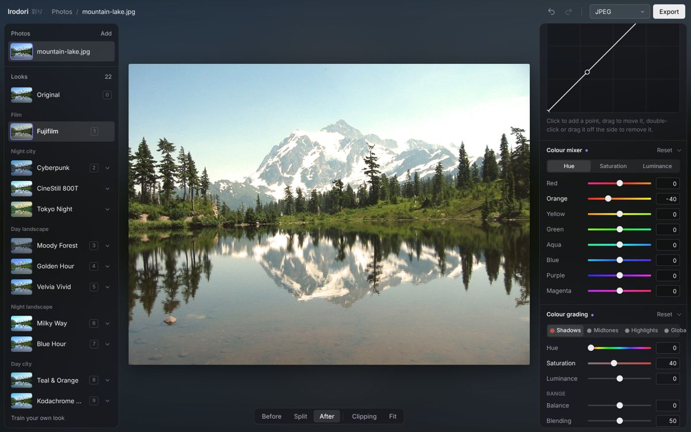
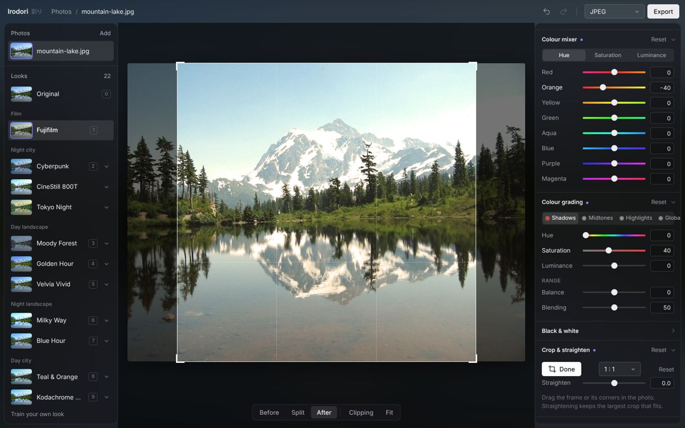

# Phase 19 report: editor foundations

*2026-11-15. Plan amendment A6, Phase 19.*

## What was done

1. **Reference pipeline** (`photostyle/pipeline.py`). Linear Rec. 2020 working space, white balance
   as channel gains, exposure, hue-preserving tone on luminance (PCHIP), Lightroom-style point
   curves, colour in Oklab (calibration, vibrance and saturation, 8-band HSL, colour grading, black
   and white), exposure-like vignette, crop and straighten, and a luminance-preserving gamut clip.
   It is differentiable in every slider. Mathematics: [`docs/pipeline.md`](../../docs/pipeline.md).
2. **WebGL2 port** (`studio/web/src/lib/pipeline.js`). One fragment shader in 32-bit float with
   dithered output. Every constant is read from `pipeline_spec.json`, generated by the reference.
3. **Edit layer.**
   - The photo's adjustments (`S.p`) are separate from the look, survive a change of look, and are
     kept per photo.
   - Undo and redo cover looks, strength, sliders, curves and crop.
   - A look of "None" is allowed.
4. **Panels.**
   - Basic: white balance with an eyedropper, exposure, contrast, highlights, shadows, whites,
     blacks, vibrance, saturation.
   - Curves: RGB, R, G and B; click to add, drag, double-click or drag off to remove.
   - Colour mixer: hue, saturation and luminance for 8 bands, with coloured tracks.
   - Colour grading: shadows, mids, highlights and global, plus balance and blending.
   - Black & white mixer, crop & straighten with aspect presets, vignette, calibration.
   - Each panel has its own reset; each slider accepts typed values and has fine steps.
5. **Viewing tools.** Zoom (wheel, pinch, Z, double-click; fit or 100 %) and pan; clipping warning
   (J); pixel readout; white-balance picker (W); crop overlay with thirds and corner handles (C).
6. **Export.** Full-resolution JPEG and PNG render through the same shader. `.cube` LUTs are
   rendered on the GPU through the same shader and read back as float where the browser allows.

The previous controls and their measured defects (A6.1) are gone. Warmth was an additive offset;
saturation ran into the look's matrix; tint pointed the wrong way; curves had 9 fixed points;
strength scaled internal parameters. Strength still scales the A5 look's parameters until Phase 21
replaces the looks.

## Why

The audit of 2026-11-14 measured controls that did not do what their labels said. A professional
editor needs controls with physically meaningful behaviour, plus a single pipeline that the
editor, the looks and training can share (A6.3).

## Tests

### 1. Invariants (`tests/test_pipeline.py`, 30 tests, 1.5 s)

Each test is a property every input must satisfy. The inputs are chosen to expose the failure each
property guards against:

| Property | Input and why |
|---|---|
| Default sliders are the identity | seeded random image: covers all colours |
| +1 stop doubles linear light | flat 0.35 grey: far from clipping, so the factor is exact |
| Tone, curve and colour controls keep greys neutral (10 settings) | flat 0.45 grey: any tint is visible as channel spread |
| White balance keeps a neutral's luminance and leaves black black (4 settings) | grey and black: the old additive warmth failed the black case |
| Temperature + is warmer, tint + is magenta | grey: the old tint was reversed |
| Saturation −100 is grey | HSV hue wheel: every hue |
| Tone curves are monotone (6 extreme settings) | 256-step grey ramp: an inversion shows as a negative step |
| Tone keeps Oklab hue within 2° | hue wheel at s = v = 0.5: unclipped, so any shift is the operator's |
| Highlights −100 recovers +1 stop | ramp: the upper half is pushed over white |
| HSL band weights sum to 1 | 721 hues: seams would show as a sum ≠ 1 |
| Vignette signs and an unchanged centre | flat grey |
| Gradients reach the sliders | random image: needed for training in Phase 21 |
| Crop equals an array slice | random image: exact half-frame crop |

All 30 pass.

### 2. Browser against reference (`tools/check_pipeline.py`, 130 cases, 131 s)

A synthetic 256×192 test image (`assets/pipeline_test_image.png`) holds:

- a grey ramp, for tone;
- a hue wheel at three saturation and lightness levels, for colour;
- skin, sky and foliage patches, for HSL bands;
- seeded noise, for everything else.

It is rendered by Chromium (WebGL2, SwiftShader, dither off) and by PyTorch in 130 cases: the
identity, every slider alone at its maximum and minimum, vignette shape, grading balance, curves,
crop and straighten, and 12 seeded random combinations of all sliders. The target (A6.6) is at
most 1 code value per channel and mean CIEDE2000 ≤ 0.5.

| | value |
|---|---|
| cases within target | **129 / 130** |
| largest mean ΔE00 over all cases | 0.015 |
| largest 99th-percentile ΔE00 | 0.54 |
| largest single-pixel difference | 3 code values (random case 6) |

**Failure, random case 6.** 7 of 49,152 pixels differ by 2–3 code values. All are in the noise
rows, near-gamut-edge yellows (e.g. input (250, 249, 12)) driven far out of gamut by extreme
settings (tint −91, contrast −92, saturation +45, vibrance +32, HSL). Perturbing the input by
$10^{-4}$ moves the reference output itself by more than 1 code value at those pixels. The
disagreement is therefore float32 rounding at an ill-conditioned point, not a defect in either
implementation, and no fix was made. The mean ΔE00 of that case is 0.005.

### 3. End-to-end editor (`tools/check_editor.py`, 30 s)

The Pages build is served under `/image_editing/` and driven through its real controls on a
sample photo, on a 1440×900 desktop and a 390×844 phone viewport.

| Check | Result |
|---|---|
| Exposure +0.8 typed into the slider changes the picture | ✓ |
| The edit survives a look change; Ctrl+Z restores the previous look | ✓ ✓ |
| Clicking the curve adds a point (3 points) | ✓ |
| Crop 1:1 gives a 768×768 output | ✓ |
| Zoom to 100 % | ✓ |
| White-balance picker sets temperature and tint (−44, +19 on a sky-blue point) | ✓ |
| JPEG export (218 kB) and a 33³ `.cube` (35,937 rows) download | ✓ |
| Page errors, desktop and phone | none |

**Test fix.** The first run reported no curve point. The test clicked at screen coordinates of the
curve canvas while it was scrolled out of view in the inspector. The test now scrolls the canvas
into view and clicks relative to it; the editor itself was not changed.

*The editor after the test's edits: Fujifilm look, exposure +0.8, a curve point, orange hue −40,
shadow grading. On the right, each section shows a dot when edited and has its own Reset; the HSL
tracks show what each slider does to its band.*

*The crop tool at 1:1. The area outside the frame is dimmed and the thirds grid helps placement;
the canvas shows the whole straightened frame while the tool is on.*

## Runtime

| Test | Runtime |
|---|---|
| Invariants | 1.5 s |
| Agreement | 131 s |
| End to end | 30 s |

## Not done in this phase

- **Residual colour table** (pipeline step 5). Its slot is reserved; it is built in Phase 21 if any
  look needs it.
- **8-bit fallback path.** The shader needs WebGL2, which is available on current iOS and Android
  browsers. There is no separate 8-bit path; float input textures (RGBA16F) are used only for
  16-bit sources.
- **Lightroom scale agreement.** Unverified (no Lightroom here).
- **Performance targets** (16.7 ms per redraw on desktop, 33 ms on a phone). Not measured in this
  phase; SwiftShader in the test container is a software renderer and says nothing about GPUs.
  Measured in Phase 26.
