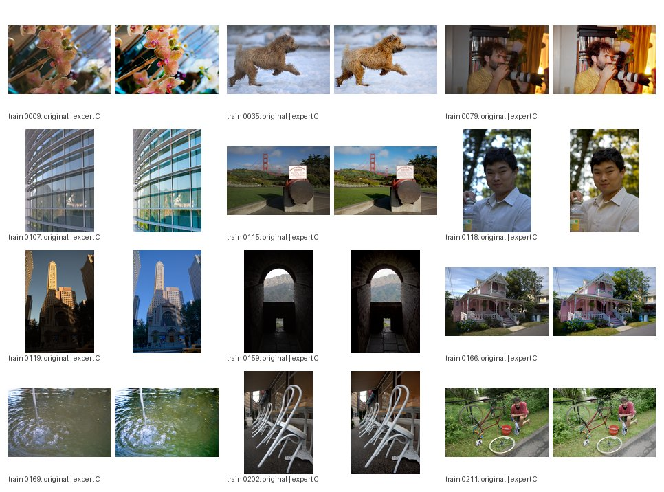

# Phase 20 report: data acquisition

*2026-11-15. Plan amendment A6, Phase 20, tasks 9–13 and 16 (data acquisition only; tasks 14
and 15 are not covered here).*

## Summary

| Task | Item | Result | Decision |
|---|---|---|---|
| 9 | Disk, memory and network budget | 29 GB free disk, 15 GB RAM shared with other work, 4 CPUs, 10–125 MB/s download | 512 px lossless proxies; peak FiveK footprint ≈ 9 GB final + ≤ 6.3 GB transient |
| 10 | MIT-Adobe FiveK, all splits, experts C, A, B, D, E | Expert C and all 5,000 originals complete (train 3,500, test 1,000, validation 500); experts A, B, D, E downloading in the background | **Go**; see the deviation on raw files below |
| 11 | PPR10K | Official Google Drive files refuse download ("quota exceeded", 2 attempts); no other complete mirror | **Blocked**; retry later; one partial alternative recorded |
| 12 | Film colour tables | 294 HaldCLUTs (RawTherapee Film Simulation Collection, CC BY-SA 4.0) and a tested loader | **Go** |
| 13 | Camera looks from raw files with embedded JPEGs | Leica previews q 18–54 or 160 px; Fujifilm previews usable, but one sample per look | **No-go** with raw.pixls.us; **conditional go** with the owner's own Fujifilm files |
| 16 | darktable as a headless reference editor | `darktable-cli` 4.6.1 installs from apt and exports a DNG in 3.3 s | **Go** for rendering; slider calibration needs generated module parameters |

**State at the time of writing (08:06 UTC).** The expert C phase finished at 08:02 UTC with no
failed shards. Experts A, B, D and E (20,000 images, about 1.5 GB each) are still downloading in
the background (`data/logs/fetch_fivek_ae.log`) at about 3,600 rows/h, so they should finish
in 4–6 h. The machine's 4 CPUs are shared with other work (load average 11 at 08:10 UTC). Re-running the
fetch command resumes and finishes them. After they finish, `tools/fivek_stats.py` updates the
counts below.

## 1. Budget (task 9)

Measured at the start: 29 GB free on `/` (`df -h .`), 15 GB RAM in one memory group shared with
another agent, 4 CPUs, no GPU. Downloads ran at 10–125 MB/s over the session's proxy, varying with
upstream load.

The proxies are 512 px on the long edge, the size the plan's earlier work trained at. A 512 px
lossless PNG costs 210–300 KB, so the five FiveK experts and the originals need about
5,000 × 6 × 0.29 MB ≈ 9 GB. The film tables add 0.4 GB. The camera-look raw files (340 MB) were
deleted after measurement, as A6.5 requires.

## 2. MIT-Adobe FiveK (task 10)

### Source and what the images are

The HuggingFace copy `logasja/mit-adobe-fivek` [[2]](#ref-hf-fivek) stores each expert as a
configuration (`a` … `e`) with splits train 3,500, test 1,000 and validation 500 (the standard
split). Each row holds two lossless WebP images and five labels (location, time, light, subject,
licence). One configuration is about 120 GB (`original` about 55 %, `augmented` 45 %).

The two images were identified by inspecting their metadata and by decoding the MIT DNG of one
row:

- **`original`** is the raw file rendered by LibRaw with the camera's white balance:
  `rawpy.postprocess(use_camera_wb=True)` reproduces it to a mean absolute difference of 0.22 code
  values (row `a4340`). It is 8-bit sRGB with the BT.709 tone curve and LibRaw's auto-brightening,
  carries no ICC profile, keeps the full sensor area (3900 × 2611 for `a4340`, against the DNG
  default crop of 3872 × 2591 at offset (14, 10)), and **ignores the camera's orientation tag**.
  It is not Adobe's rendering and not the "InputAsShotZeroed" input of the MIT release.
- **`augmented`** is the expert's Lightroom export: 8-bit, **ProPhoto RGB** (embedded ICC profile,
  pure power curve γ = 461/256 = 1.80078), cropped to the DNG default crop and rotated upright. Its
  XMP packet holds the expert's settings (`crs:Temperature`, `crs:Exposure2012`, tone curve and so
  on).

Row order was checked for all five configurations: the FiveK id (`a0001` …) in every row of every
split of `a`, `b`, `d` and `e` equals the id in the same row of `c` (agreement 1.0 in every split;
`data/fivek/.state/alignment.json`). Files are nevertheless keyed by id against the order of `c`,
so the layout would stay correct if the dataset were re-sharded.

### Processing

For each row, $v \in \{0,\dots,255\}^3$ is decoded to linear light in the image's own primaries:

$$
c_\text{orig} = \text{sRGB}^{-1}(v/255), \qquad c_\text{exp} = (v/255)^{\gamma},\ \gamma = 1.80078 .
$$

Both are evaluated exactly through a 256-entry table, since 8-bit input has only 256 values.

1. **Orientation and crop.** For each rotation $k \in \{0,1,2,3\}$ whose rotated original can hold
   the expert's frame, the original is centre-cropped to that frame. Both images are reduced to
   64 px luminance thumbnails $t_o, t_e$ and scored by the Pearson correlation
   $r_k = \langle \hat t_o, \hat t_e \rangle / n$, with $\hat t = (t - \bar t)/\sigma_t$. The
   correlation is invariant to the expert's affine tone changes, and a wrong rotation gives a
   near-zero or negative score. The best $k$ and its $r$ are recorded. A few originals (cameras
   with non-square photosites) are smaller than the expert's export but have the same aspect
   ratio (within 1 %); they are used whole and scaled.
2. **Resize in linear light** to 512 px on the long edge (Lanczos after an integer box
   reduction, Pillow `reducing_gap = 3`). Averaging linear values is averaging radiance, which is
   what a lower-resolution sensor records; averaging gamma-encoded values darkens high-contrast
   edges. The original is resized to exactly the expert proxy's pixel size, so every pair has
   identical dimensions.
3. **Encode** with the same transfer function and primaries and save as **PNG**. The expert keeps
   its ProPhoto ICC profile. Its XMP is saved alongside as `img_NNNN.xmp`.

Expert pixels are **not** converted to sRGB on disk. The loader `decode_linear_srgb`
(`tools/fetch_fivek.py`) converts on load with

$$
c_\text{sRGB,lin} = M_\text{sRGB}^{-1}\, M_\text{ProPhoto}\, c_\text{exp},
$$

where each $M$ has as columns the D50-adapted XYZ colorants ($r_{XYZ}, g_{XYZ}, b_{XYZ}$) of that
profile. This is the ICC matrix-shaper path with relative-colorimetric intent [[1]](#ref-icc), so
no constants are typed in. It agrees with LittleCMS to a mean of 0.006–0.025 code values (maximum 1,
from rounding) on four rows. Values below 0 or above 1 mark colours outside sRGB; a training
pipeline in linear Rec. 2020 can keep them.

### Decisions and their measurements

**PNG, not JPEG.** Four expert images were encoded at 512 px in several ways and compared with the
lossless proxy in CIEDE2000:

| Encoding | Size (KB) | Mean ΔE₀₀ | p99 ΔE₀₀ |
|---|---|---|---|
| PNG (lossless) | 213–303 | 0 | 0 |
| JPEG q 95, 4:4:4 | 63–115 | 0.89–1.60 | 3.9–6.7 |
| JPEG q 95, 4:2:0 | 47–80 | 1.13–2.16 | 6.1–12.1 |
| JPEG q 90, 4:2:0 (previous tool) | 32–55 | 1.27–2.48 | 6.5–13.0 |

The residual-table rule of A6.4 fires at a held-out ΔE₀₀ of 2, and the benchmark resolves
differences of that order, so a storage error of 1–1.6 on average would be the same size as the
quantity being measured. PNG triples the size, which the disk budget allows.

**Native ProPhoto, not sRGB.** On the same four rows, 7–43 % of expert pixels lie outside sRGB.
Clipping them to sRGB shifts colour by a mean of 0.15–3.45 ΔE₀₀ over the whole image, and by
1.6–8.0 on the affected pixels, which is a visible change to the expert's intent. The original is
already sRGB (LibRaw clips to sRGB), so this asymmetry is inherent in the source.

**Expert settings kept.** The XMP files (≈ 10 KB each) give each expert's actual Lightroom slider
values for each photo. They are the closest available ground truth for the slider-space model of
A6.4 and for the oracle study (task 17), at about 3 % of the disk cost.

**Download path.** Each parquet shard is one row group whose image columns are each a single
dictionary page of about 1 GB (Snappy). pyarrow loads such a page whole and needed about 2.9 GB
per worker. The tool therefore fetches only the needed column chunks with parallel HTTP range
requests into a sparse local file, then reads the dictionary page from a memory map and walks its
PLAIN values (`[uint32 length][bytes]`). It falls back to pyarrow whenever the layout differs.
Peak anonymous memory is about 1.0 GB per column, and the output matched pyarrow's byte for byte
on a test shard. Configurations `a`, `b`, `d` and `e` download only the `augmented` column, which
saves about 260 GB of transfer.

### Counts, disk use and statistics

| Split | Originals | Expert C | Disk (originals + expert C + XMP) |
|---|---|---|---|
| train | 3,500 | 3,500 | 2.06 GB |
| test | 1,000 | 1,000 | 0.58 GB |
| validation | 500 | 500 | 0.29 GB |
| **total** | **5,000** | **5,000** | **2.93 GB** |

Per image: original PNG 282 KB, expert PNG 284 KB, XMP 10.7 KB (means). Each further expert adds
about 1.5 GB, so the five experts will occupy about 8.9 GB. Transient disk use: up to three
shard files of at most 2.1 GB in `data/fivek/.tmp/`, deleted after each shard.

Taken from the per-row records (`data/fivek/{split}/expert_c/img_NNNN.json`). The baseline uses
200 seeded rows per split (`tests/reports/phase20_fivek_stats.json`):

| Quantity | train | test | validation |
|---|---|---|---|
| Rotation applied to the original: none / 90° / 180° / 270° (`np.rot90` k = 0, 1, 2, 3) | 2279 / 620 / 9 / 592 | 700 / 155 / 2 / 143 | 329 / 92 / 3 / 76 |
| Originals smaller than the export (scaled) | 29 | 8 | 5 |
| Alignment correlation r: p5 / median / min | 0.910 / 0.980 / 0.190 | 0.903 / 0.980 / 0.703 | 0.909 / 0.980 / 0.718 |
| Expert C pixels outside sRGB: median / p95 | 4.6 % / 34 % | 5.1 % / 35 % | 5.1 % / 37 % |
| Expert C crops (`crs:HasCrop`) | 1 | 0 | 0 |
| Identity baseline, original vs expert C: mean ΔE₀₀ / PSNR | 10.4 / 19.8 dB | 10.3 / 19.8 dB | 10.2 / 20.1 dB |

34 % of the originals needed a rotation: portrait photos turned by 90° either way, plus 14
photos turned by 180°. The 180° cases were inspected and are correct. Seventeen rows have
r < 0.8. Those inspected (train 108, 155, 540) are correctly registered: the expert brightened a
night or indoor scene, or darkened a sky, so the luminance patterns differ. **One pair is
broken.** Train 2152 (`a4949`) has the only cropped expert export (3687 × 2950 of 5634 × 3752),
its original is visibly distorted, and r = 0.19. Excluding `align_r < 0.6` in
`data/manifests/fivek.csv` removes exactly this row.

The identity baseline is not comparable with published FiveK figures. Those use Adobe's
"as shot" rendering as the input, whereas these originals are LibRaw renders with
auto-brightening.



*Twelve training pairs drawn with a fixed seed. In each pair the left image is the original
proxy and the right image is expert C's edit, converted from ProPhoto RGB to sRGB for display.
Each pair should show the same framing; portrait photos (0107, 0118, 0119, 0159, 0202) are
upright in both halves, which confirms the orientation search. The differences are the expert's
edit: brighter exposure (0119, 0202), neutralised white balance (0079, 0118), and more colour and
contrast in skies and foliage (0115, 0166, 0211). The originals are LibRaw renders without
Lightroom's default tone curve, so they look flatter than a camera JPEG would.*

### Problems found

- **The previous tool `tools/download_fivek_subset.py` (and `download_fivek_landscapes.py`, which
  shares its approach) produced wrong pairs.** It saved the ProPhoto experts as JPEG without the
  profile, so every reader treats them as sRGB and sees them desaturated. It also resized the
  unrotated original and the upright expert independently, so 34 % of pairs (1,692 of 5,000 rows
  needed a rotation, almost all by 90°) are misregistered. Any model trained on those
  pairs (A5, `tests/reports/mit5k_expert_c_report.md`) learned from both errors. The tool was not
  changed, because it is outside this task; `tools/fetch_fivek.py` replaces it.
- **Deviation from task 10.** The plan asks for FiveK raw files decoded through our own raw path.
  The HuggingFace copy has no raw files; its originals are LibRaw renders with auto-brightening.
  The MIT site serves each DNG and each expert's 16-bit TIFF as individual files
  (`https://data.csail.mit.edu/graphics/fivek/img/dng/<id>.dng`, `.../img/tiff16_c/<id>.tif`;
  verified for `a4340`: 8.8 MB DNG). Once Phase 22's raw path exists, the originals can be rebuilt
  from the DNGs by per-file download, decode to a 16-bit linear proxy, and delete, as A6.5
  requires. The expert targets from HuggingFace remain valid (8-bit ProPhoto against the MIT
  16-bit ProPhoto).
- The shared memory group ran out twice: once killing the camera-look probe, once a FiveK worker
  while three pyarrow-based workers each held about 3 GB. The driver retries failed shards (up to
  five attempts) and per-row resumption loses no finished work. The dictionary-page reader and
  smaller orientation thumbnails then cut each worker to about 1.7 GB.

## 3. PPR10K (task 11)

PPR10K [[3]](#ref-ppr10k) is distributed only through Google Drive and Baidu Netdisk (README of
`csjliang/PPR10K`). The Drive folder is public and lists zip files: 360p sources (16-bit TIFF,
540 × 360), the three experts' 360p targets, 360p and full masks, the experts' XMP settings, and
the raw files in 38 parts (313 GB). Every file, including the 130 MB XMP zips, returned Google's
"Quota exceeded: too many users have viewed or downloaded this file recently" page at 05:51 and
06:28 UTC. Google lifts this within 24 h. Baidu requires an account and client. The Drive
identifiers are listed in `data/manifests/ppr10k_sources.csv` for a later retry.

The only HuggingFace mirror, `JarvisArt/MMArt-PPR10k` (4,055 samples, apache-2.0 card), holds
`before.jpg` and `processed.jpg` at 1024 px with Lightroom settings (`config.xmp`, process version
11). Its edits are JarvisArt's instruction-driven retouches (for example "slightly warmer tone and
a bit more sharpness", Temperature 6450), not the PPR10K experts a, b and c, and it has no masks.
It was therefore not downloaded. It may still be useful later: exact modern Lightroom slider
values paired with renders could calibrate our slider scales (A6.10, question 2).

### Retry (15 November, afternoon)

The quota had lifted. `tools/fetch_ppr10k.py` reads the four 360p zips in place over HTTP range
requests (sources 12.1 GB, each expert about 4.6 GB, 11,161 files each; together more than the disk
allowance) and keeps 270 px sRGB PNG proxies. Every file checked carries the standard sRGB
IEC61966-2.1 profile (sources 16-bit, retouches 8-bit). After about 1 GB per zip (924 sources and
1,832 expert-a retouches) Drive returned the quota page again; only ranges of about 100 bytes were
still served. The tool resumes where it stopped, so later attempts continue the download. The
official split (first 8,875 files train, last 2,286 test; README) is laid out by `--split`.

## 4. Film colour tables (task 12)

**Source.** `http://rawtherapee.com/shared/HaldCLUT.zip` (the HTTPS address resets in this
environment; plain HTTP served the file). The archive is 421,602,289 bytes, sha256
`0ffca81f30c72d7bbb85adab0ed98bbdeb0e1034cd6f5986f9f993bb66999dc2`. It is the RawTherapee Film
Simulation Collection version 2015-09-20, licensed CC BY-SA 4.0 (Pat David, Pavlov Dmitry, Michael
Ezra) [[4]](#ref-rt). It was extracted to `data/film_luts/` with its folder structure: Color
(Agfa 3, CreativePack-1 33, Fuji 62, Kodak 47, Lomography 2, Polaroid 80) and Black-and-White
(Agfa 2, Fuji 19, Ilford 15, Kodak 14, Polaroid 12, Rollei 4), plus `Negative.png`, the identity
`Hald_CLUT_Identity_12.tif` and the README. 293 tables are level 12 (144³ nodes); Kodak Ektar 100
is level 16 (256³). Every table maps sRGB code values to sRGB code values.
`data/manifests/film_luts.csv` lists each table with level, sha256, source, licence, and its mean
and maximum deviation from the identity (median mean deviation 33/255; Kodak Portra 400 24–27,
Fuji Velvia 50 18).

**Loader** (`photostyle/haldclut.py`). A HaldCLUT of level $L$ is an image of side $L^3$ holding
$N = L^2$ nodes per axis. Pixel $i$ in raster order holds the output for node
$(r, g, b) = (i \bmod N,\ \lfloor i/N \rfloor \bmod N,\ \lfloor i/N^2 \rfloor)$ [[5]](#ref-hald).
`load_haldclut` reshapes the image to $(N, N, N, 3)$, which is indexed $[b, g, r]$, and transposes
it to **$[r, g, b]$**. `apply_haldclut` interpolates trilinearly: with $x = c\,(N-1)$,
$i = \min(\lfloor x \rfloor, N-2)$ and $f = x - i$ per channel,

$$
\text{out} = \sum_{d \in \{0,1\}^3} \prod_{k} \big(f_k^{d_k} (1-f_k)^{1-d_k}\big)\;
\text{lut}[i + d] .
$$

Trilinear interpolation is exact for affine maps, so an identity table reproduces its input up
to the half code value of 8-bit node quantisation.

**Tests** (`tests/test_haldclut.py`, 5 tests, 0.24 s):

| Test | Input and why |
|---|---|
| Identity round trip < 1/255, levels 4 and 8 | an identity table written to PNG and loaded back; 20,000 seeded random colours plus the 8 cube corners, where the cell index is capped |
| Index order is [r, g, b] | a table mapping (r, g, b) → (g, b, r); a [b, g, r] mix-up would return a different permutation |
| Nodes are exact | random table, inputs exactly on nodes: no interpolation error allowed (< 1e-5) |
| Non-cube image rejected | a 100 × 100 image (100 is not $L^3$) |

The shipped identity TIFF also agrees with `identity_haldclut(12)` to within 1 code value (mean
0.25, from rounding), which checks the index convention on real data.

The second half of task 12 (the tutorial authors' preset files) is not part of this acquisition
and was not attempted.

## 5. Camera looks (task 13)

**Data.** Ten CC0 raw files from raw.pixls.us [[6]](#ref-rpu) (340 MB, deleted after
measurement; sources in `data/manifests/camera_looks_sources.csv`). The `data-unique` set has no
Leica folder, so `data/` was used. Leica M10, SL (Typ 601), CL, Q (Typ 116) and M (Typ 240);
Fujifilm X-T3, X-T4, X100V, X-Pro2 and X100F.

**Method** (`tools/probe_camera_looks.py`, 72 s).

1. Extract the embedded JPEG with `rawpy` `extract_thumb()`.
2. Estimate its IJG quality by encoding a probe image at every quality 1–100 and choosing the one
   whose luminance quantisation table is closest in L1 to the camera's. No table is typed in.
3. Decode the raw to linear sRGB with camera white balance (2 × 2 binning), choose the rotation by
   luminance correlation, centre-crop to the preview's aspect ratio, and resize to the preview
   (at most 2048 px).
4. Match brightness with one exposure gain.
5. Fit a global colour map (24³ cells over the sRGB-encoded decode; each cell holds the mean JPEG
   colour) on a random half of the pixels and measure CIEDE2000 on the other half. Do this for the
   whole frame and for the central half box-downsampled 8×. The second variant removes
   misregistration from lens correction: Leica CL, Q and SL DNGs carry `WarpRectilinear` opcodes,
   which the camera's JPEG applies and LibRaw does not.

| Camera | Preview (px) | IJG quality | Look (exiftool) | ΔE₀₀ decode vs JPEG | ΔE₀₀ global map, centre, held out (p95) |
|---|---|---|---|---|---|
| Fujifilm X-T3 | 4416 × 2944 | 96 | Classic Chrome, shadows +2 | 9.1 | 2.6 (9.0) |
| Fujifilm X-T4 | 4416 × 2944 | 96 | Provia | 10.0 | 4.2 (14.6) |
| Fujifilm X100V | 4416 × 2944 | 96 | Velvia | 10.7 | 3.3 (8.5) |
| Fujifilm X-Pro2 | 1920 × 1280 | 77 | Provia | 11.6 | 6.5 (18.3) |
| Fujifilm X100F | 1920 × 1280 | 83 | Provia, soft tone | 9.9 | 3.4 (8.3) |
| Leica CL | 6000 × 4000 | 54 | – | 5.7 | 2.4 (7.3) |
| Leica M10 | 5952 × 3968 | 49 | – | 9.3 | 4.1 (10.1) |
| Leica Q (Typ 116) | 6000 × 4000 | 18 | – | 13.7 | 3.9 (8.9) |
| Leica SL (Typ 601) | 6000 × 4000 | 18 | – | 9.9 | 3.1 (7.2) |
| Leica M (Typ 240) | 160 × 120 | 95 | – | 18.6 | 9.8 (26.4) |

All embedded JPEGs use 4:2:2 chroma. The full table, including whole-frame figures, is in
`data/manifests/camera_looks.csv`.

**Interpretation.** The camera renderings differ strongly from a neutral decode (5.7–13.7 ΔE₀₀
after matching exposure), so a look is there to learn. The Leica previews are not suitable
training targets. The Q and SL previews are compressed at IJG quality 18 (mean luminance quantiser
147, so 8 × 8 blocks are visibly coarse), the M10 and CL at about 50, and the M (Typ 240) embeds
only a thumbnail. These are previews, not the camera's JPEG output. Modern Fujifilm bodies
(X-T3, X-T4, X100V) embed a full-size quality-96 JPEG, which is the camera's own rendering.
However, raw.pixls.us holds one file per body, and each file uses a different film simulation
and tone setting, so there is one sample per look. Even fitted to the same photo, a global colour
map leaves 2.6–4.2 ΔE₀₀ on the central region. This is above the residual-table threshold of 2,
which points to tone or local processing that a global map does not capture. With one photo per
look, how much of that comes from residual misregistration cannot be separated.

**Decision.**

- **Leica: no-go** from embedded previews. It needs RAW + JPEG pairs shot by the owner.
- **Fujifilm: no-go with raw.pixls.us; conditional go** with about 30 or more of the owner's own
  RAF files from a 2018+ body for each film simulation and tone setting, using the embedded
  full-size JPEG. The expected floor of the slider + residual-table class is about 3 ΔE₀₀ on these
  measurements; a spatial (local-tone) component would be needed to go below it.

## 6. darktable (task 16)

`apt-get install --no-install-recommends darktable` installs 4.6.1 (Ubuntu 24.04) in under two
minutes. The command `darktable-cli <dng> <out.jpg> --width 1024 --height 1024 --core --configdir
<dir> --library :memory:` exported the FiveK DNG `a4340` in 3.3 s, headless. Its only warning is
about running as root. **Go** for using darktable as a reference renderer.

Comparing slider responses (A6.6) also needs XMP sidecars with chosen module parameters.
darktable stores these as versioned binary structures (hex or gzip-base64), so a small generator
per module (exposure, colour balance, filmic or sigmoid) is the remaining work. It was not
attempted within the time box.

## Files

| Path | Content |
|---|---|
| `tools/fetch_fivek.py` | FiveK fetcher (index, alignment check, range download, colour handling, orientation, proxies, manifest); also the loader `decode_linear_srgb` |
| `tools/fivek_stats.py` | statistics of this report → `tests/reports/phase20_fivek_stats.json` |
| `tools/fivek_contact_sheet.py` | contact sheet of this report |
| `tools/probe_camera_looks.py` | camera-look probe → `data/manifests/camera_looks.csv` |
| `photostyle/haldclut.py`, `tests/test_haldclut.py` | HaldCLUT loader and tests |
| `data/manifests/fivek.csv` | one row per photo: split, index, FiveK id, labels, sizes, per expert size, crop flag and out-of-gamut fraction |
| `data/manifests/film_luts.csv`, `ppr10k_sources.csv`, `camera_looks_sources.csv`, `camera_looks.csv` | other manifests |
| `data/fivek/`, `data/film_luts/` | images (git-ignored, never committed) |

Rebuild commands (each idempotent and resumable):

```bash
uv run python tools/fetch_fivek.py --experts c,a,b,d,e --workers 3   # log: data/logs/fetch_fivek.log
curl -sS -o /tmp/HaldCLUT.zip http://rawtherapee.com/shared/HaldCLUT.zip   # then unzip HaldCLUT/* into data/film_luts/
uv run python tools/fivek_stats.py && uv run python tools/fivek_contact_sheet.py
uv run pytest -q tests/test_haldclut.py
```

## Runtime

| Step | Wall time |
|---|---|
| Whole session (probing, tools, downloads, report) | 05:36–08:10 UTC, 2 h 34 min |
| FiveK index of all five configurations (376 shards, metadata only) | ≈ 5 min |
| FiveK expert C and originals (5,000 rows, 3 workers, including two restarts) | 06:07–08:02 UTC, 1 h 55 min; last uninterrupted run 5,190 s; ≈ 3,300 rows/h |
| FiveK experts A, B, D, E | running since 08:04 UTC; ≈ 3,600 rows/h, 4–6 h expected with shared CPUs |
| HaldCLUT download (421 MB) and extraction | ≈ 1 min |
| `tests/test_haldclut.py` (5 tests) | 0.24 s |
| Camera-look probe (10 files) | 72 s, plus ≈ 1 min download |
| darktable install / one export | < 2 min / 3.3 s |
| `tools/fivek_stats.py` (600 baseline pairs) | 82 s |

## References

<span id="ref-icc">[1]</span> International Color Consortium (2010). *Specification ICC.1:2010
(profile version 4.3.0.0)*, §F.3 (matrix/TRC models). [Link](https://www.color.org/specification/ICC1v43_2010-12.pdf)

<span id="ref-hf-fivek">[2]</span> Bychkovsky, V., Paris, S., Chan, E., Durand, F. (2011).
*Learning photographic global tonal adjustment with a database of input/output image pairs.* CVPR.
Data: [MIT](https://data.csail.mit.edu/graphics/fivek/), copy used:
[HuggingFace logasja/mit-adobe-fivek](https://huggingface.co/datasets/logasja/mit-adobe-fivek).

<span id="ref-ppr10k">[3]</span> Liang, J., Zeng, H., Cui, M., Xie, X., Zhang, L. (2021).
*PPR10K: A large-scale portrait photo retouching dataset with human-region mask and group-level
consistency.* CVPR. [Link](https://github.com/csjliang/PPR10K)

<span id="ref-rt">[4]</span> RawTherapee (2015). *Film Simulation Collection, version
2015-09-20* (CC BY-SA 4.0). [Link](http://rawpedia.rawtherapee.com/Film_Simulation)

<span id="ref-hald">[5]</span> Steenberg, E. *Hald CLUT.* [Link](http://www.quelsolaar.com/technology/clut.html)

<span id="ref-rpu">[6]</span> raw.pixls.us, *Raw sample archive* (CC0 1.0). [Link](https://raw.pixls.us/)
