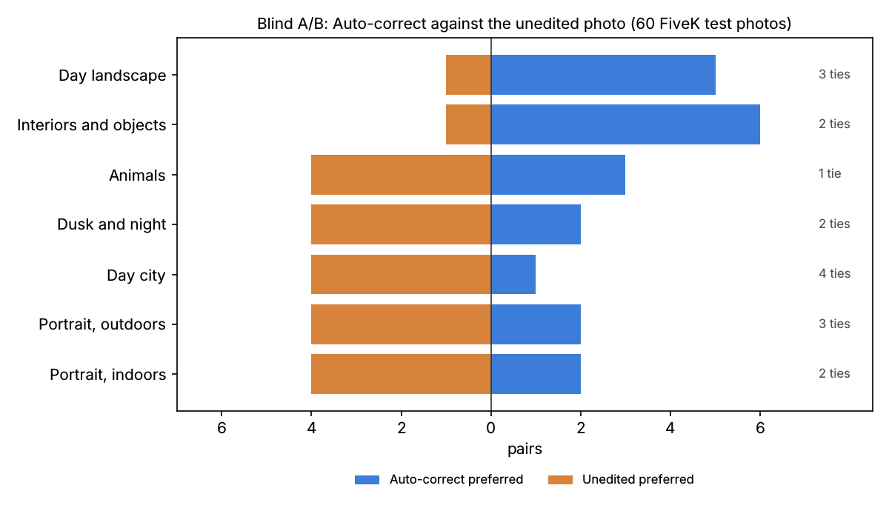

# Phase 20 task 14: the owner's blind A/B ratings of Auto-correct

*2026-11-15. Plan amendment A6.6 ("Owner's judgement").*

## What was done

The owner compared, blind, each of 60 photos shown unedited and with Auto-correct, the base
correction model of Phase 21 (`photostyle/models/auto_c.pt`, trained on FiveK expert C), and chose
the better starting point for editing, or *No preference*.

- **Photos** (`tools/make_rating_set.py`): 60 FiveK test photos, never seen in training, drawn with
  a fixed seed and stratified over seven groups built from the FiveK labels to approximate the
  editor's look categories (8–9 per group).
- **Blinding**: each pair under a random three-digit id; the side of the Auto-correct version drawn
  at random (A 27 times, B 33 times); the key kept off the rating page (`data/rating/key.json`,
  local). Images at 512 px on a neutral 18 % grey surround.
- **Why**: A6.6 makes the owner's ratings the definition of "better" where they disagree with the
  metrics, and the Phase 21 gate asks that the base model beat the unedited photo in them.
- Per-pair data, unblinded: [`phase20_rating.json`](phase20_rating.json).

## Results

| | Pairs |
|---|---|
| Auto-correct preferred | 21 |
| Unedited preferred | 22 |
| No preference | 17 |

With ties dropped, 21 of 43 decisions favour Auto-correct (49 %); a two-sided sign test gives
$p = 1.0$. There is **no preference** for Auto-correct overall, although it gains 2.0 dB and 2.0
ΔE00 toward expert C on the same test split.

*Each row is one group of 8–9 photos. Blue bars count pairs where Auto-correct was preferred,
orange bars pairs where the unedited photo was, and the ties are listed on the right. The model
won in landscapes (5–1) and interiors and objects (6–1), and lost in city, night and portrait
photos (1–4 to 2–4).*

**Interpretation.**

- **Groups.** No group differs significantly on its own (exact binomial, $p$ from 0.125 for
  interiors and objects to 1.0). The landscape and interiors groups together favour the model
  11–2 and the rest favour the original 10–20, but this split was found after looking at the
  data, so it is a hypothesis to test, not a result.
- **What was rejected.** Where the unedited photo won, the model's edits were larger (mean
  |slider| sum 196 against 172 when it won, 138 for ties) and differed mainly in three ways.

  | Slider | Mean when unedited won | Mean when Auto-correct won |
  |---|---|---|
  | Exposure | +0.67 EV | +0.41 EV |
  | Shadows | +14 | +5 |
  | Temperature | −7 | −1 |

  The rejected corrections brighten, lift shadows and cool the picture: expert C's habits, which
  the owner does not share for people, cities and night scenes.
- **Ties.** 17 of 60 pairs were indistinguishable. These had the smallest edits, consistent with
  the Phase 21 finding that the model is conservative.
- **Position.** B was chosen 26 times and A 17 times ($p = 0.22$), with Auto-correct on B in 33
  of 60 pairs, so no position bias is detectable.

**Consequence for the plan.** The Phase 21 gate, "beats the unedited photo in the owner's
ratings", is **not met**. The metric gain toward expert C does not carry over to the owner's taste.
The options, for the owner to decide:

1. Make Auto-correct off by default, keeping it as a one-click option.
2. Retrain toward a different target: another FiveK expert, or PPR10K for portraits (being
   downloaded); then re-rate on a fresh set.
3. Learn the owner's own corrections from their edits (A6.10, question 1), the only target that
   matches their taste by construction.

## Runtime

Rating set generation 2 min; the owner's rating session is not timed; analysis under 10 s.
