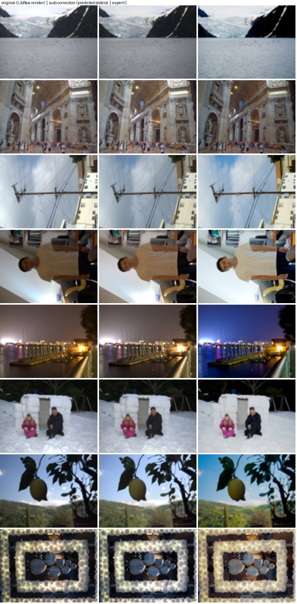
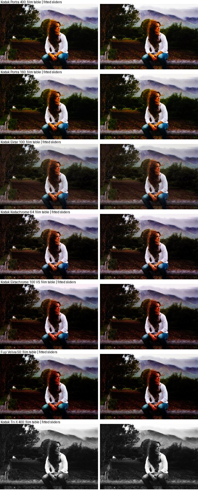

# Phase 21 report: slider-space models

*2026-11-15. Plan amendment A6, Phase 21.*

## What was done

1. **Oracle study** (`tools/oracle_study.py`). For 64 FiveK training photos, the best slider
   values per photo were found by gradient descent on the Oklab distance to expert C's edit. This
   bounds what any model predicting those sliders can reach.
2. **Range probe.** The same fit with the slider limits lifted, on 32 photos, to see how far the
   experts' edits push each slider.
3. **Tone-slider scales revised** from the probe (below).
4. **Base correction model** (`photostyle/auto.py`, `tools/train_auto.py`). It predicts the ten
   correction sliders (temperature, tint, exposure, contrast, highlights, shadows, whites, blacks,
   vibrance, saturation) from the existing 1280-D descriptor (frozen ResNet-18 plus channel CDFs).
   - The loss is the mean Oklab distance to expert C plus $\lambda = 0.003$ × the L1 norm of the
     sliders.
   - Training renders through the differentiable pipeline at 128 px, on 3,499 training pairs; the
     500 validation photos selected the configuration and the 1,000 test photos were held out.
   - The model is the `auto_c` entry of `styles.json` and is applied in the browser as an
     *Auto-correct first* layer, on by default.
5. **Tutorial looks as slider settings** (`photostyle/slider_looks.py`). The 21 tutorial looks
   (20 plus Cyberpunk) are now exactly their recipe's slider values. They need no network, so
   `styles.json` shrank from 5.3 MB to 0.5 MB, and their example panels were re-rendered through
   the pipeline. Fujifilm, trained on film scans, keeps its learned head, as the plan says.
6. **Film looks fitted to film colour tables** (`tools/fit_film.py`; results below).

## Data correction during this phase

The Phase 20 data agent found that the FiveK expert edits are 8-bit **ProPhoto RGB** with an
embedded profile, and that a third of the originals needed rotating.

- My first loader read the experts as sRGB, which desaturated every target. The first oracle run
  and the first training run used those wrong targets; both were stopped and repeated with
  colour-managed decoding and resizing in linear light (`auto._read_linear`).
- The older FiveK tools (`tools/download_fivek_subset.py`, `download_fivek_landscapes.py`) had
  both faults, so the A5-era FiveK results (`mit5k_expert_c_report.md`) were measured on wrong
  pairs. Those models were local-only and never published.

## Results

### Oracle and the slider ranges (64 training photos, 96×128 px)

| | Oklab distance ×100 | PSNR | mean ΔE00 |
|---|---|---|---|
| Unedited (original against expert C) | 8.22 | 20.41 dB | 10.19 |
| Oracle, 10 correction sliders, original ranges | 2.43 | 28.79 dB | 3.66 |
| Oracle, limits lifted (32 photos) | 1.71 | — | — |

With the original ranges, the oracle hit the limit for whites on 97 % of photos, blacks on 80 %,
highlights on 47 % and shadows on 23 %. With the limits lifted, the experts needed medians of
whites −229, blacks −202, highlights −56 and shadows −52. That is a strong highlight shoulder and
shadow toe, the S-shaped curve raw converters apply by default and the FiveK originals lack.

**Decision.** Whites and blacks were made 3× stronger, and highlights and shadows 1.5× (the
`TONE_ROWS` in `photostyle/pipeline.py`). The experts' typical edits now fall within ±100, and the
sliders come closer to Lightroom's, whose whites and blacks are strong.

Side effect: tutorial looks keep their published slider numbers, so their whites and blacks act
more strongly than before.

The configurations that add the 24 HSL sliders and a free curve were not completed: both runs
were stopped at the 30-minute background limit.

### Base correction model

| | Validation (500) PSNR | ΔE00 | Test (1,000) PSNR | ΔE00 |
|---|---|---|---|---|
| Unedited | 20.49 dB | 9.81 | 20.39 dB | 9.95 |
| Head width 256, dropout 0.2, 30 epochs | 22.33 dB | 7.91 | — | — |
| **Head width 64, dropout 0.3, weight decay 1e-3, 12 epochs (shipped)** | **22.52 dB** | **7.81** | **22.37 dB** | **7.92** |

*Each row is a held-out test photo: the FiveK original (left), the model's correction (middle)
and expert C's edit (right). The corrections go in the expert's direction (lower whites, more
saturation, small exposure changes) but are milder: on the night harbour, the expert's cool
white balance is barely attempted.*

**Interpretation.**

- The model gains 2.0 dB and 2.0 ΔE00 on unseen photos. The oracle shows that up to about 8 dB
  is available to these sliders with perfect per-photo knowledge.
- Validation stopped improving after about 5 epochs while the training loss kept falling, and the
  smaller network did slightly better. The predicted slider medians are about a sixth of the
  oracle's; for example whites −38 against about −76 on the new scale. The model regresses toward
  a mild average edit, which is safe as a default but conservative.
- **Owner's ratings.** In a blind A/B test on 60 other test photos the owner had no preference
  between Auto-correct and the unedited photo (21–22, 17 ties; [rating report](phase20_rating.md)):
  the gain toward expert C is not a gain in the owner's eyes.
- What limits it is how much of each expert decision the frozen ImageNet descriptor can predict,
  not the slider set. Expected improvements, not tried here:
  - fine-tuning the backbone;
  - training at a higher resolution;
  - adding curve outputs;
  - training on all five experts.
- Published FiveK numbers are not comparable: they use Adobe's renders of the raw files as inputs,
  whereas this copy's originals are LibRaw renders (Phase 20 report).

### Expert styles 

*Added after the FiveK download of experts A, B, D and E finished (task 22).* One model per
retoucher predicts the ten correction sliders and the 24 colour-mixer sliders (34 outputs). The
configuration is the shipped Auto-correct one (head width 64, dropout 0.3, weight decay 1e-3,
12 epochs, λ = 0.003), not re-tuned per expert. Each model sees 3,499 training pairs; the scores are
on the 1,000 test photos against that expert's own edits.

| Expert | Unedited PSNR | Model PSNR | Unedited ΔE00 | Model ΔE00 |
|---|---|---|---|---|
| A | 20.78 dB | 21.99 dB | 9.60 | 8.04 |
| B | 22.80 dB | 24.70 dB | 8.47 | 6.62 |
| C | 20.39 dB | 22.43 dB | 9.95 | 7.88 |
| D | 19.85 dB | 22.06 dB | 11.02 | 8.37 |
| E | 18.95 dB | 22.87 dB | 12.15 | 8.02 |

**Interpretation.**

- Every model moves the photos toward its expert, by 1.2 dB (A) to 3.9 dB (E). The gain is
  largest where the expert departs most from the unedited photo (E, D): a strong, consistent style
  is easier to predict than a subtle one.
- For expert C, adding the colour mixer gains 0.06 dB over Auto-correct's ten sliders (22.43
  against 22.37 dB) at the same ΔE00. The experts' edits are mostly tone and white balance; the
  colour mixer adds expressiveness to the look rather than accuracy.
- The five models are the editor's **Expert styles** group (`expert_a` … `expert_e`, 0.35 MB of
  weights each before float16 encoding).

### Tutorial looks as slider settings

Rendering each recipe through the pipeline differs from the old `develop.py` renders by 2–18/255
(mean, on 27 photos). The two implementations scale the sliders differently, and neither is
calibrated against Lightroom. In a side-by-side review the slider versions look similar or more
natural (Moody Forest keeps its greens; Autumn and Bright Food are less overcooked). Bright & Airy,
Bright Food and CineStill are milder.

### Film looks 

Twelve stocks from the RawTherapee Film Simulation Collection (CC BY-SA 4.0) were fitted as slider
settings: tone, white balance, vibrance, saturation, 8-band HSL, colour grading, calibration and
R, G, B point curves; the two black-and-white stocks use the B&W mix in place of colour.

The fit was gradient descent on the Oklab distance to the table's output, over 32 FiveK photos
as edited by expert C (well exposed, close to neutral). The error is measured on 16 other photos.

| Stock | Table against the unedited photo (ΔE00) | Fitted sliders against the table (ΔE00) |
|---|---|---|
| Kodak Portra 400 | 6.18 | 1.44 |
| Kodak Portra 160 | 5.77 | 1.07 |
| Kodak Ektar 100 | 3.04 | 1.14 |
| Kodak Kodachrome 64 | 6.57 | 1.46 |
| Kodak Ektachrome 100 VS | 7.31 | 1.59 |
| Fuji Velvia 50 | 5.63 | 1.69 |
| Fuji Provia 100F | 3.82 | 1.72 |
| Fuji Pro 400H | 5.44 | 1.25 |
| Fuji Superia 400 | 7.24 | 1.56 |
| Agfa Vista 200 | 5.11 | 1.30 |
| Kodak Tri-X 400 | 11.74 | 0.68 |
| Ilford HP5 Plus 400 | 11.88 | 0.79 |

*Left: the film table applied to a photo. Right: the fitted slider look. They are hard to tell
apart.*

Every stock is below the residual-table threshold of ΔE00 2 (A6.4), so no residual colour table
is needed. The twelve are in the editor as the **Film stocks** group: ordinary slider looks that
can be edited like any other. Each is credited to the collection in its card.

## Not done

- **The colour and curve oracle configurations.** Stopped at the time limit.
- **Residual colour tables.** Not built: every fitted look is below the threshold, so none is
  needed.

## Runtime

| Step | Runtime |
|---|---|
| Loading and descriptors, first time | 1,211 s (cached afterwards) |
| Shipped training run | 393 s, after caching |
| Oracle, correction configuration | about 25 min |
| Range probe | about 15 min |
| Expert styles, per expert (two in parallel, loading included) | 1,970–2,100 s; C 322 s with cached pairs |
