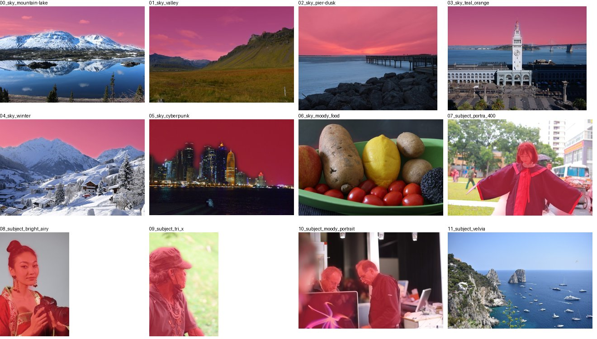

# Phases 22–25 report: raw and export, local adjustments, finishing and optics, workflow

*2026-11-15. Plan amendment A6, Phases 22–25. Every operator below has a reference implementation
in `photostyle/pipeline.py` and a WebGL2 port in `studio/web/src/lib/pipeline.js`, documented
with its mathematics in [`docs/pipeline.md`](../../docs/pipeline.md).*

## What was done

### Phase 22: raw input and export

- **Raw files in the browser** with LibRaw compiled to WebAssembly (`libraw-wasm`, ISC licence,
  1.4 MB, loaded only when a raw file is opened). The decode keeps camera white balance and the
  camera colour matrix, outputs linear Rec. 2020 (the working space) at 16 bits, without
  auto-brightening or gamma.
  - A baseline gain places the 99th-percentile luminance at 0.9, so the brightest 1 % stays above
    white as recoverable headroom.
  - The editor receives float data, never an 8-bit preview. The shader takes linear input
    directly.
- **Colour.** Output in sRGB or Display P3; the 8-bit exports carry their colour space through
  the browser's encoder.
- **Export.**
  - JPEG with quality and the photo's EXIF (orientation reset to upright); PNG.
  - 16-bit PNG and 16-bit TIFF, encoded in JavaScript from a float render target. The PNG carries
    an sRGB or cICP chunk.
  - A long-edge resize.
  - `.cube` LUTs rendered on the GPU through the same shader.
  - A Lightroom / Camera Raw preset (`.xmp`): sliders, curves, crop.

### Phase 23: local adjustments

Up to four masks:

- **Shapes:** linear gradient, radial (rotation, feather), painted brush, or the whole photo.
- **Range limits:** a luminance range and an Oklab colour range.
- **Invert.**

Each mask has twelve local sliders: temperature, tint, exposure, contrast, highlights, shadows,
whites, blacks, saturation, clarity, texture and dehaze. They combine as
$s(p) = s + \sum_j m_j(p)\,s_j$. The tone curve is then rebuilt per pixel, so the luminance
ratio, and with it hue preservation, still holds inside masks. On the photo: gradient and radial
handles, brush painting (size, hardness, flow, erase) and an overlay of the masked area (O).

### Phase 24: finishing and optics

- **Detail:** texture, clarity, dehaze (dark-channel prior), sharpening with edge masking, and
  luminance and colour noise reduction. They are computed from local means at three scales on the
  GPU (a preparation pass, then 2× box steps and separable Gaussians).
- **Effects:** film grain (identical PCG-hash noise in Python and GLSL) and halation.
- **Geometry:** perspective (vertical, horizontal), lens distortion and scale, added to crop and
  straighten.
- **Lens blur:** depth of field from Depth Anything V2 Small (Apache-2.0, 27 MB quantised ONNX,
  downloaded only on request and run on the device). The blur is an occlusion-aware disc gather
  in linear light, with a focus picker and a depth view. This is the counterpart of Leica LUX's
  aperture mode.

### Phase 25: workflow and phone

- **Kept between visits.** Photos and edits are stored in the browser's IndexedDB, on the device
  only.
- **Offline and installable.** A service worker caches the app and the model; a web manifest and
  icons allow installing to the home screen.
- **Moving settings.** Copy and paste of settings, *Sync all*, user presets, snapshots, and a
  labelled history whose steps can be revisited.
- **Match a reference photo.** A coordinate search on exposure, contrast, temperature, tint and
  saturation, measured on 96-pixel renders through the real pipeline.
- **Phones.** *Share* saves to the photo library. A phone checklist for the owner is in
  [`docs/phone_checklist.md`](../../docs/phone_checklist.md).

## Why

These are the tools the A6 plan lists for professional editing:

- raw files, so there is latitude to recover highlights and shadows;
- local adjustments;
- detail, optics and finishing;
- a workflow that does not lose work.

Lens blur answers the owner's question about Leica LUX.

## Tests

### Agreement of the browser with the reference (`tools/check_pipeline.py`)

The method is as in Phase 19: render the same image in Chromium and in PyTorch, then compare.

| Group | Cases | Result |
|---|---|---|
| Per-pixel controls (Phase 19) and geometry | 131 | all within 1 code value except one ill-conditioned case (Phase 19 report) |
| Masks: linear, radial inverted, luminance range, colour range, brush, four combined | 6 | all within target; brush mean ΔE00 0.025 |
| Perspective, lens distortion, scale | 1 | max 1 code value |
| Spatial operators on a real photo (misty forest, 640 px) | 10 | all within target; largest mean ΔE00 0.32 (dehaze) |
| Spatial operators on the synthetic image | 10 | 7 within target; dehaze +60, colour NR and halation miss (mean ΔE00 0.9–1.2) |
| Lens blur on a real photo (portrait) | 1 | mean ΔE00 0.044 |
| Lens blur on the synthetic image | 1 | mean ΔE00 0.77, misses |

**Spatial operators.** The GPU builds its local means from a downsampled pyramid; the reference
uses one full-resolution Gaussian. The two agree closely on photographs. On the synthetic image's
seeded noise rows and hard-edged hue bands they differ most, and the dehaze division by the
transmission amplifies the difference.

**Two bugs found and fixed by these tests.**

- **Flipped local means.** The GPU textures were read upside down (render targets store the top
  row at $t = 1$), so the blurs came from the mirrored image: mean ΔE00 of 6 to 18 on the first
  run.
- **Grain hash.** Python's operator precedence (`a | b ^ c` is `a | (b ^ c)`) made its grain hash
  differ from the shader's. After the fix the grain is identical (max difference 1 code value from
  rounding).

**Lens blur.** On the synthetic image, the occlusion test (is a sample nearer than the pixel?) is
an all-or-nothing comparison that tiny rounding differences can flip on the noise rows. It agrees
on a photograph.

### End-to-end (`tools/check_editor.py`)

The Pages build is driven through its controls. Raw files are CC0 samples from raw.pixls.us.

| Check | Result |
|---|---|
| Leica Q (DNG) opens; 16-bit TIFF export | 8.2 s to open; 145 MB TIFF |
| Leica M10 (DNG) | 8.9 s; 143 MB TIFF |
| Fujifilm X100V (RAF, X-Trans) | 35 s (X-Trans demosaicing in WebAssembly); 156 MB TIFF |
| Raw files start with contrast +20 | ✓ |
| 16-bit PNG export | bit depth 16, colour type 2, sRGB chunk ✓ |
| Lightroom preset contains the edit | `Exposure2012="+0.80"` and a `ToneCurvePV2012` ✓ |
| Clarity and grain change the picture | ✓ |
| Linear-gradient mask with local exposure changes the picture | ✓ |
| A brush stroke is stored with the mask | ✓ |
| Page errors (desktop, phone viewport) | none |

The Phase 25 checks (copy and paste, history, service worker, reload) were added afterwards; their
results are in the [Phase 26 report](phase26_release.md).

### Learned masks: sky and subject (task 31, added 16 November)

**What.** In the browser, **+ Sky** and **+ Subject** in the Masks section select the sky or the
people in a photo. The model is SegFormer-B0 fine-tuned on ADE20K (150 scene classes; sky is class
2, person 12), used as Xenova's ONNX export. It is 15 MB in fp32, within the owner's download
budget, is downloaded once on first use, and runs on the device with onnxruntime-web.

Its weights are under the NVIDIA Source Code License for non-commercial research use. That suits
this personal project, as with the FiveK data. A commercial release would need another model.

The model's class probability comes out at 128 × 128. It is upsampled and refined against the
photo's luminance with a guided filter (He et al. 2010; `learnedmask.js`), with a radius of 1 % of
the long edge and $\epsilon = 10^{-3}$. The filter fits a local linear map $q = aI + b$ from
luminance $I$ to the coarse probability, so the mask follows real edges (ridges, rooftops, hair)
instead of the model's 8-px cells.

The result is stored as a painted mask with a label. The brush can correct it, and history,
persistence, the Python reference and export treat it like any other mask.

**Why.** The A6 plan lists learned masks among the local tools a professional editor needs. They
waited on the download budget, which the owner approved on 16 November ("ok" to up to about
40 MB).

**Test (`tools/check_masks.py`).** The built site is served locally and driven in Chromium. Twelve
unedited example photos were used:

- seven for **Sky**: landscapes, a lake, a seascape, a city in daylight, a night skyline, and a
  food photo with no sky;
- five for **Subject**: four portraits, and a coast with no people.

They were chosen to cover hard sky boundaries (snowy ridges, a lit skyline at night) and to
include photos without the class. For the sky, the result is compared with the Python side's
sky mask (`photostyle/sky.py`), which uses UperNet with a ConvNeXt backbone, about 15× the size,
by intersection over union of the masks thresholded at 0.5.

| Photo | Mask | Share selected | IoU with the reference | Time |
|---|---|---|---|---|
| Mountain lake | sky | 0.32 | 0.994 | 4.0 s |
| Valley | sky | 0.43 | 0.996 | 6.7 s |
| Pier at dusk | sky | 0.47 | 0.992 | 7.4 s |
| San Francisco waterfront | sky | 0.36 | 0.995 | 6.3 s |
| Snowy village | sky | 0.28 | 0.994 | 5.9 s |
| Night skyline | sky | 0.46 | 0.958 | 5.9 s |
| Fruit and vegetables (no sky) | sky | 0.005 | 1.0 (both empty) | 4.9 s |
| Outdoor portrait | subject | 0.30 | — | 5.3 s |
| Studio portrait | subject | 0.49 | — | 6.4 s |
| Documentary portrait | subject | 0.48 | — | 6.0 s |
| Two men indoors | subject | 0.37 | — | 6.7 s |
| Coast (no people) | subject | 0.0 | — | 5.7 s |

*Each panel shows the selected area tinted red. The sky masks follow the ridges, the tower and the
lit skyline closely. The subject masks take whole people, including small figures in the
background and a camera held in front of the body, because the class is "person", not "main
subject". The food photo and the coast are left (almost) empty.*

The night skyline has the lowest agreement (IoU 0.958). The two models differ on the glow just
above the lit towers. The times are for inference on this machine's CPU (WebAssembly); the first row
also includes the 15 MB download, after which the model is cached. No page errors. Runtime of the whole check: 115 s.

**Not done.** A "main subject" mask for objects other than people would need a salient-object
model; none was added within this scope.

### Tiled export and memory limits (task 28, added 16 November)

**What and why.** An iPhone 14 Pro (the owner's phone) takes 48-megapixel ProRAW photos. Rendering one in a single pass
needs a 48 MP half-float source texture (387 MB), three full-size work textures for the detail
means and a full-size float output (774 MB). Safari also refuses canvases above 16.7 MP
(4096 × 4096), which the 8-bit encoders used. Above those limits the export now renders in tiles:

- **Output tiles.** The output is drawn in 2048 px tiles (`pipeline.js` `renderTiled`). Each tile
  draws from the source window it maps to through the crop and geometry, widened by the reach of
  the 1-pixel detail means ($3\sigma$) and of the lens-blur radius. The shader takes the tile's
  place in the full frame (`tileUV`, `tileOff`) and the source window (`srcWin`) as uniforms, so
  every coordinate-dependent operation (vignette, grain, masks, geometry) is computed in
  full-frame coordinates.
- **Coarse local means.** These feed clarity, dehaze and halation and are computed once for the
  whole photo, from full-resolution pixels, tile by tile (`coarseTiled`). Each tile's core is
  reduced into its place in a shared half-, quarter- or eighth-resolution texture, and the
  Gaussian blurs then run on the shared textures. A first version took these means from a
  2048 px copy of the photo. Halation and dehaze extract nonlinear quantities (highlight excess
  above a threshold, the dark channel) before averaging, so that version lost small bright
  lights. It missed by up to 58 code values; the tests below caught it.
- **Raw sources.** These are read window by window from the 16-bit decode (`raw.js`
  `rawSource`), so the full float image is never held.
- **Output buffers.** 16-bit output is kept as 16-bit RGB (290 MB at 48 MP, against 774 MB as
  float). Above 16.7 MP, JPEG is encoded with `jpeg-js` (BSD-3-Clause, loaded only then) and PNG
  with the editor's own PNG writer, both in sRGB. For Display P3 at that size, export PNG 16-bit,
  which carries a cICP tag.
- **When it applies.** Tiling is used when the source or the output exceeds 16.7 MP or the GPU's
  texture size. Smaller exports are unchanged.

**Test: tiled against one-pass rendering (`tools/check_tiles.py`).** The input is a real
23.9-megapixel photo: the CC0 Leica M10 DNG, developed with rawpy. It was chosen because it is
above the canvas limit and has both fine detail and bright point lights. It is rendered in
headless Chromium in one pass and in 700 px tiles; small tiles give many seams to test. Both
renders are 16-bit, so there is no dithering. Values are in 8-bit code values.

| Case | Max difference | Mean ΔE00 | Largest difference at a seam |
|---|---|---|---|
| Per-pixel controls | 1 | 0.001 | 1 |
| Spatial operators (texture, clarity, sharpening, noise reduction, dehaze, halation) | 2 | 0.004 | 1 |
| Two masks with local clarity | 1 | 0.001 | 1 |
| Geometry (crop, 3.5° rotation, perspective, distortion) | 1 | 0.001 | 1 |
| Grain | 1 | 0.001 | 1 |

The tiles are invisible: no case differs by more than 2 code values anywhere, or by more than 1
along a seam. In the editor itself (`tools/check_editor.py`), a forced tiled export of the sample
photo matches the one-pass export to 0.001 code values on average in 16 bits. In 8 bits the mean
difference is 1.2, which is the dither noise plus JPEG re-encoding. Runtime of the comparison:
1,238 s, under SwiftShader. In this test the tiled path took up to 1.4× the one-pass time
(spatial case: 73 s against 51 s), because each tile repeats the prep pass over its margin.

**Not tested here:** a real 48 MP export on the phone. It is in the phone checklist (steps 15 and 16).

## Not done

- **Spot removal.** Out of scope (A6.9).
- **The phone checklist on a real phone.** It waits on the owner.

## Runtime

| Test | Runtime |
|---|---|
| Agreement test, full run | 594 s |
| Raw end-to-end run | 67–138 s |
| Mask, lens and perspective agreement runs | 30–130 s each |
